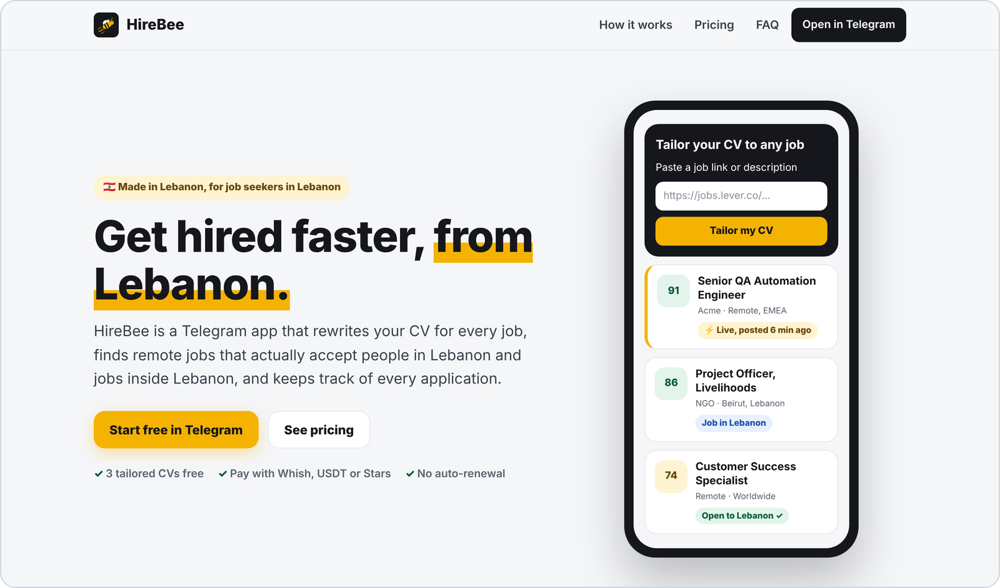
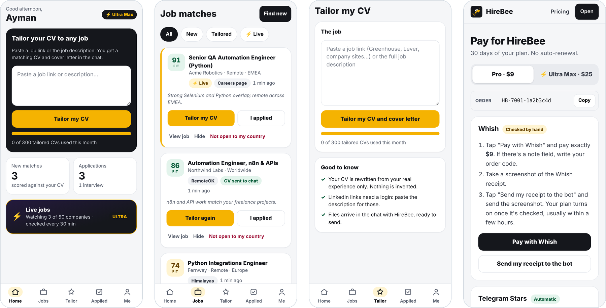

<div align="center">

<a href="https://aymanaghi.github.io/hirebee/">
  <picture>
    <source media="(prefers-color-scheme: dark)" srcset="assets/readme/logo-dark.svg">
    
  </picture>
</a>

<h3>Get hired faster, from Lebanon.</h3>

<p>
HireBee is a Telegram app that rewrites your CV for every job,<br>
finds remote jobs that accept people in Lebanon and jobs inside Lebanon,<br>
and keeps track of every application.
</p>

<a href="https://aymanaghi.github.io/hirebee/"></a>&nbsp;&nbsp;<a href="https://t.me/HireBeee_bot"></a>

<sub>🇱🇧 Made in Lebanon&nbsp;&nbsp;·&nbsp;&nbsp;Free to start&nbsp;&nbsp;·&nbsp;&nbsp;Whish, USDT or Telegram Stars&nbsp;&nbsp;·&nbsp;&nbsp;No auto-renewal</sub>

<br><br>



</div>

<br>

## How it works

Three steps, all inside Telegram. No new app to install.

| 1. Add your CV | 2. Get matched | 3. Apply with a tailored CV |
| :-- | :-- | :-- |
| Upload your CV (PDF or Word) or build one step by step in the chat. | HireBee scores new jobs against your CV and sends you the good ones, checked for whether people in Lebanon can apply. | One tap gives you a CV and cover letter rewritten for that job, as files ready to send. |

## Built for the Lebanese job market

Most job tools ignore Lebanon. HireBee starts from it.

| | |
| :-- | :-- |
| ✍️&nbsp;&nbsp;**A tailored CV for every job** | Your CV and cover letter rewritten for each job from your real experience. Nothing is invented. |
| 🌍&nbsp;&nbsp;**Remote jobs open to Lebanon** | Dollar-paying remote jobs in every field from five remote job boards, with jobs that exclude Lebanon filtered out. |
| 🇱🇧&nbsp;&nbsp;**Jobs inside Lebanon** | NGO and UN jobs in Lebanon from ReliefWeb, plus the career pages of companies you choose to follow. |
| ⚡&nbsp;&nbsp;**Be first to apply** | Ultra Max watches up to 50 company career pages and alerts you within 30 minutes of a new job. |
| 📋&nbsp;&nbsp;**Track every application** | Applied, replied, interview, offer: see where everything stands and follow up on time. |
| 💳&nbsp;&nbsp;**Pay the way you already pay** | Whish, USDT on TON (Keeper wallet) or Telegram Stars. No bank card needed. |

## Inside the app

<div align="center">

<br>
<sub>Home&nbsp;&nbsp;·&nbsp;&nbsp;Job matches&nbsp;&nbsp;·&nbsp;&nbsp;Tailor my CV&nbsp;&nbsp;·&nbsp;&nbsp;Payment page</sub>
</div>

## Plans

Pay for 30 days at a time. Nothing renews by itself.

| | **Free** | **Pro** | **⚡ Ultra Max** |
| :-- | :--: | :--: | :--: |
| **Price** | $0 | **$9** / 30 days | **$25** / 30 days |
| Tailored CVs + cover letters | 3 | 100 a month | 300 a month |
| Build or upload your CV | ✅ | ✅ | ✅ |
| Application tracker | ✅ | ✅ | ✅ |
| Daily job matches: remote and in Lebanon | | ✅ | ✅ |
| Country check on every job | | ✅ | ✅ |
| Skill gaps and interview prep | | ✅ | ✅ |
| Live jobs from 50 company career pages, checked every 30 minutes | | | ✅ |
| More jobs scored for you every day | | | ✅ |

Not happy? You get a full refund within 7 days of paying, as long as you've tailored 5 CVs or fewer. See the [refund policy](https://aymanaghi.github.io/hirebee/refunds.html).

## Paying

| Method | How it works | When your plan turns on |
| :-- | :-- | :-- |
| **USDT on TON** | Tap "Open in Keeper" on the payment page: the amount, address and your order code are filled in. | Automatically, within a few minutes |
| **Whish** | Pay the exact amount with Whish, then send the receipt screenshot to the bot. | Once it's checked, usually within a few hours |
| **Telegram Stars** | Pay inside Telegram: 700 ⭐ for Pro, 1,950 ⭐ for Ultra Max. | Straight away |

## Browse jobs

The [Jobs page](https://aymanaghi.github.io/hirebee/jobs.html) lists jobs open to people in Lebanon, updated after every scan: search, filter by Lebanon, Remote, Gulf or field, and tap **Tailor my CV** to open HireBee on that job. Every job links to its original posting and names its source.

**Hiring?** Employers post jobs for free: open [@HireBeee_bot](https://t.me/HireBeee_bot?start=post) and follow the steps. Every post is checked before it goes up.

## Where the jobs come from

- **Remote jobs:** RemoteOK, Remotive, Himalayas, We Work Remotely, Jobicy, Working Nomads and Arbeitnow, in every field, keeping only jobs open to people in Lebanon.
- **Jobs in Lebanon:** NGO and UN jobs from ReliefWeb, company careers pages, jobs Lebanese employers post on HireBee, and Lebanese job channels on Telegram that agreed to share their posts.
- **Jobs in the Gulf:** on-site jobs in the UAE, Saudi Arabia and the rest of the GCC from company careers pages, for people open to relocating.
- **Live jobs (Ultra Max):** the career pages of companies you follow, on Greenhouse, Lever, Ashby, Workable and SmartRecruiters.

HireBee doesn't copy jobs from LinkedIn or Bayt, and it never applies or sends anything in your name: you choose where to apply.

## Your data

- Your CV is used only to make your documents and find matching jobs. It's never sold.
- Send `/delete` to the bot at any time to erase everything.
- Read the [privacy policy](https://aymanaghi.github.io/hirebee/privacy.html) and [terms](https://aymanaghi.github.io/hirebee/terms.html).

<br>

---

<br>

## About this repository

This repository is the HireBee **website**: plain HTML, CSS and JavaScript with no build step, hosted free on GitHub Pages. The Telegram bot and Mini App are not in this repository.

```text
hirebee/
├── index.html          Home: how it works, features, latest jobs, pricing, FAQ
├── jobs.html           Jobs open to people in Lebanon: search and filters
├── pay.html            Payment page: USDT on TON, Whish, Telegram Stars
├── terms.html          Terms of service
├── privacy.html        Privacy policy
├── refunds.html        Refund policy
├── contact.html        Contact details
├── config.js           Settings: bot username, contact details, prices, wallet address
├── site.js             Fills every page from config.js
├── jobs.js             Shows jobs.json on the Jobs page and the home page
├── jobs.json           The job list, written by the HireBee bot after every scan
├── style.css           All styles, light theme
├── favicon.svg         Icons and the link preview card
├── favicon-32.png
├── apple-touch-icon.png
├── og-share.png
├── wallet-logo.png     Google Wallet pass images (logo and banner)
├── wallet-hero.png
└── assets/readme/      Images used in this README
```

<details>
<summary><b>Setup and deployment</b> (for the maintainer)</summary>

<br>

**1. Settings.** Open `config.js` and set:

| Setting | What it is |
| :-- | :-- |
| `botUsername` | The bot's username without @ (`HireBeee_bot`) |
| `contactEmail` | Where users and Whish can reach you |
| `contactPhone` | Optional |
| `whishLink` | Your Whish payment link |
| `tonAddress` | Your Keeper wallet's **public** address (UQ… or EQ…). Leave empty to hide the USDT option. |
| `prices`, `stars`, `days` | Must match the bot's `.env` |

> [!WARNING]
> Everything in this repository is public. Never put a private key, recovery phrase, bot token or API key here.

Until `botUsername` and `contactEmail` are set, a red reminder bar shows at the top of every page.

**2. GitHub Pages.** Settings → Pages → Build and deployment: Source "Deploy from a branch", branch `main`, folder `/ (root)`, Save. The site goes live at `https://aymanaghi.github.io/hirebee/` after a minute or two. Every new commit updates it.

**3. Connect the bot.** In the bot's `.env`:

```env
WEBSITE_CHECKOUT_URL=https://aymanaghi.github.io/hirebee/pay.html
```

The bot adds each user's order code to that link (`?code=…&plan=…`).

**4. Jobs page.** The bot commits `jobs.json` here after each scan once `GITHUB_TOKEN` is set in its `.env`
(a fine-grained token for this repository only, with Contents: Read and write). Until then the Jobs page says the
first jobs are on their way, and the home page hides its Latest jobs section.

**5. Moving to your own domain.** Each page's `<head>` points `og:image` to `https://aymanaghi.github.io/hirebee/og-share.png`. Change that line in every page, and add a `CNAME` file with the domain.

The terms, privacy and refund pages are a plain-language starting point, not legal advice. Read them and change anything that doesn't match how you work.

</details>

<br>

<div align="center">
<sub>Built in Lebanon by <a href="https://github.com/aymanaghi">Ayman Naghi</a>&nbsp;&nbsp;·&nbsp;&nbsp;© 2026 HireBee. All rights reserved.</sub>
</div>
